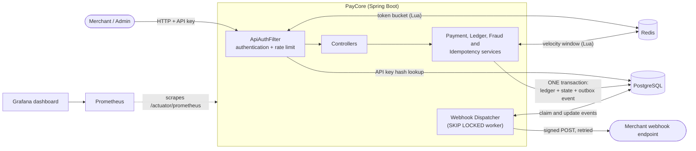
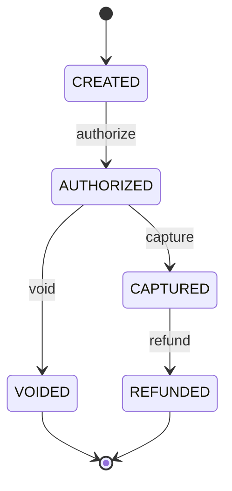

<div align="center">

# PayCore

**A concurrency-safe payment processing backend: double-entry ledger, idempotent APIs, fraud screening, signed webhooks and distributed rate limiting.**


</div>

PayCore is a small payment processor in the spirit of Stripe or Razorpay. It focuses on the hard parts of moving money
reliably: never charging twice, never overdrawing under concurrency, never losing an event, screening for fraud, and being
able to prove that the books balance.

---

## Table of Contents

- [Highlights](#highlights)
- [Architecture](#architecture)
- [Quick Start](#quick-start)
- [Authentication](#authentication)
- [Payment Lifecycle](#payment-lifecycle)
- [API Walkthrough](#api-walkthrough)
- [Fraud Screening](#fraud-screening)
- [Webhooks](#webhooks)
- [Design Decisions](#design-decisions)
- [Testing and CI](#testing-and-ci)
- [Performance](#performance)
- [Observability](#observability)
- [Configuration Reference](#configuration-reference)
- [Project Structure](#project-structure)
- [Limitations & Roadmap](#limitations--roadmap)

---

## Highlights

| Area | What it does |
|---|---|
| **Double-entry ledger** | Append-only entries; every transfer is a matched debit and credit. A reconciliation endpoint proves the books balance. |
| **Payment state machine** | `CREATED → AUTHORIZED → CAPTURED → REFUNDED` (or `VOIDED`) with illegal transitions rejected. |
| **Idempotency** | `Idempotency-Key` header; retries never double-charge, even when sent simultaneously. |
| **Concurrency safety** | Pessimistic row locks in a fixed order (no deadlocks), plus a database `CHECK` as a backstop. |
| **Authentication** | Hashed, revocable merchant API keys with strict tenant isolation; separate admin key. |
| **Rate limiting** | Redis token bucket executed atomically in Lua; `429` with `Retry-After`. |
| **Fraud screening** | Sliding-window velocity rule (declines) and large-amount rule (holds for manual review), both enforced server-side. |
| **Webhooks** | Transactional outbox, HMAC-signed requests, exponential backoff with jitter, dead-letter queue and replay. |
| **Scalability work** | Escrow sharding removed a single-row lock bottleneck: **4.4× throughput** (673 → 2,991 req/s) and **−80% p95 latency** in k6 load tests. |
| **Observability** | Prometheus metrics and a ready-made Grafana dashboard: throughput, latency percentiles, payment flow, fraud decisions, webhook queues, DB pool and CPU. |
| **Automated tests + CI** | Integration tests run the real app against real PostgreSQL and Redis containers (Testcontainers) on every push. |

---

## Architecture



Every state change writes the ledger entries, the new payment status **and** the webhook event in a single database
transaction. Nothing is sent to the outside world until that transaction has committed.

---

## Quick Start

**Requirements:** Docker Desktop. Python 3 only for the test scripts.

```bash
docker compose up --build
```

| Service | Address |
|---|---|
| Backend API | `http://localhost:8080` |
| Swagger UI | [localhost:8080/swagger-ui.html](http://localhost:8080/swagger-ui.html) (use the **Authorize** button) |
| PostgreSQL | `localhost:5432` |
| Redis | `localhost:6379` |

Optional monitoring (Prometheus + Grafana): `docker compose --profile monitoring up -d --build`, then open
[localhost:3000](http://localhost:3000). See [Observability](#observability).

---

## Authentication

| Caller | Header | Used for |
|---|---|---|
| **Admin** | `X-Admin-Key: dev-admin-key` (set `ADMIN_KEY` to change) | Create accounts, deposits, issue/revoke API keys, review queue, `/admin/**` |
| **Merchant** | `Authorization: Bearer pk_...` | `/payments/**` and `/webhooks/**`, scoped to that merchant only |

- API keys are 256-bit random values. Only a SHA-256 hash is stored and the key is shown **once**.
- A merchant requesting another merchant's payment gets `404`, indistinguishable from a payment that does not exist.
- Idempotency keys are scoped per caller, so two merchants using the same string never collide.

---

## Payment Lifecycle



A payment created with `riskFlag: REVIEW` cannot be authorized until an admin approves it (see
[Fraud Screening](#fraud-screening)).

### Money movement

| Operation | Source | Destination |
|---|---|---|
| Deposit | `FUNDING` | Customer |
| Authorize | Customer | Escrow shard |
| Capture | Escrow shard | Merchant |
| Void | Escrow shard | Customer |
| Refund | Merchant | Customer |

> **Precision:** all amounts are integers in minor units (paise). Floating point is never used for money.

---

## API Walkthrough

> Prefer clicking? Everything below is also available in Swagger UI.

```bash
ADMIN='X-Admin-Key: dev-admin-key'
```

**1. Create accounts** (admin) and note the returned ids as `CUSTOMER` and `MERCHANT`:

```bash
curl -s -X POST localhost:8080/accounts -H "$ADMIN" -H 'Content-Type: application/json' \
  -d '{"name":"alice","type":"CUSTOMER"}'
curl -s -X POST localhost:8080/accounts -H "$ADMIN" -H 'Content-Type: application/json' \
  -d '{"name":"shop","type":"MERCHANT"}'
```

**2. Issue a merchant API key** (admin). Save `apiKey` as `KEY`:

```bash
curl -s -X POST localhost:8080/admin/merchants/$MERCHANT/api-keys -H "$ADMIN" \
  -H 'Content-Type: application/json' -d '{"name":"demo"}'
```

**3. Deposit ₹500.00** into the customer (admin):

```bash
curl -s -X POST localhost:8080/accounts/$CUSTOMER/deposit -H "$ADMIN" \
  -H 'Content-Type: application/json' -H 'Idempotency-Key: dep-1' -d '{"amount":50000}'
```

**4. Create a ₹120.00 payment** (merchant). Save the returned `id` as `PAYMENT`:

```bash
curl -s -X POST localhost:8080/payments -H "Authorization: Bearer $KEY" \
  -H 'Content-Type: application/json' -H 'Idempotency-Key: pay-1' \
  -d "{\"customerId\":\"$CUSTOMER\",\"merchantId\":\"$MERCHANT\",\"amount\":12000}"
```

**5. Authorize, then capture** (merchant):

```bash
curl -s -X POST localhost:8080/payments/$PAYMENT/authorize -H "Authorization: Bearer $KEY" -H 'Idempotency-Key: auth-1'
curl -s -X POST localhost:8080/payments/$PAYMENT/capture   -H "Authorization: Bearer $KEY" -H 'Idempotency-Key: cap-1'
```

**6. Verify the books** (admin):

```bash
curl -s localhost:8080/admin/reconcile -H "$ADMIN"
```

### Endpoint reference

| Method | Path | Auth | Purpose |
|---|---|---|---|
| `POST` | `/accounts` | Admin | Create a `CUSTOMER` or `MERCHANT` account |
| `GET` | `/accounts/{id}`, `/accounts/{id}/ledger` | Admin | Balance and ledger entries |
| `POST` | `/accounts/{id}/deposit` | Admin | Fund an account (idempotent) |
| `POST` | `/admin/merchants/{id}/api-keys` | Admin | Issue an API key (shown once) |
| `DELETE` | `/admin/api-keys/{id}` | Admin | Revoke an API key |
| `GET` | `/admin/reconcile` | Admin | Verify balances against the ledger |
| `GET` | `/admin/review-queue` | Admin | Payments held for manual review |
| `POST` | `/admin/payments/{id}/approve` | Admin | Release a payment held for review |
| `POST` | `/payments` | Merchant | Create a payment (idempotent; fraud-screened) |
| `GET` | `/payments/{id}` | Merchant | Read a payment you own |
| `POST` | `/payments/{id}/authorize \| capture \| void \| refund` | Merchant | State transitions (idempotent) |
| `POST` `GET` | `/webhooks` | Merchant | Register / list webhook endpoints |
| `DELETE` | `/webhooks/{id}` | Merchant | Deactivate an endpoint |
| `GET` | `/webhooks/events?status=DEAD` | Merchant | Inspect deliveries (`PENDING`, `DELIVERED`, `DEAD`) |
| `POST` | `/webhooks/events/{id}/replay` | Merchant | Re-queue a dead event |

---

## Fraud Screening

Every `POST /payments` is screened **before** the payment is created.

| Rule | Trigger | Outcome |
|---|---|---|
| **Velocity** | More than 60 payment attempts by one customer within 60 seconds | Declined with `422`; nothing is created |
| **Large amount** | Amount ≥ ₹1,00,000 (10,000,000 paise) | Payment is created with `riskFlag: REVIEW`; `authorize` returns `409` until an admin approves it |

- **How the velocity window works:** a Redis sorted set per customer, updated by one atomic Lua script (trim old entries,
  add this attempt, count). It is a true sliding window, so there is no boundary effect at the minute mark, and it works
  across several app servers. Declined attempts still count, so a card-testing bot stays blocked while it keeps trying.
- **Review workflow:** `GET /admin/review-queue` lists held payments; `POST /admin/payments/{id}/approve` releases one and
  emits a `payment.review_approved` webhook. Merchants cannot approve their own reviews.
- **Availability over strictness:** if Redis is unreachable the velocity check fails open (like the rate limiter).
- Thresholds are configurable (see [Configuration Reference](#configuration-reference)).

---

## Webhooks

Register an endpoint with `POST /webhooks` and PayCore notifies it of `payment.created`, `payment.authorized`,
`payment.captured`, `payment.voided`, `payment.refunded` and `payment.review_approved`.

### Delivery guarantees

- **At-least-once.** Receivers must de-duplicate on the event `id`. Ordering is not guaranteed.
- **Retries** with exponential backoff and ±20% jitter: 2s, 4s, 8s, 16s, 32s, 64s, 128s (defaults), then the event moves to
  `DEAD` (the dead-letter queue). A merchant can fix their server and `replay` it.
- **Crash safe.** Workers claim events with a time-limited lease; if a server dies mid-delivery, another retries.

### Verifying the signature

Every request carries `X-PayCore-Signature: t=<unix seconds>,v1=<hex HMAC-SHA256>` computed over `"<t>." + raw body`
with your endpoint's secret.

```python
import hashlib, hmac, time

def verify(secret: str, header: str, raw_body: bytes) -> bool:
    parts = dict(p.split("=", 1) for p in header.split(","))
    expected = hmac.new(secret.encode(), parts["t"].encode() + b"." + raw_body, hashlib.sha256).hexdigest()
    return hmac.compare_digest(expected, parts["v1"]) and abs(time.time() - int(parts["t"])) < 300
```

The timestamp check rejects replays of captured requests.

---

## Design Decisions

### 1. Double-entry ledger
Every transfer writes a matching `DEBIT` and `CREDIT` linked by a transaction id. The ledger is append-only, and
`/admin/reconcile` verifies that each stored balance equals its ledger sum and that total debits equal total credits.

### 2. Pessimistic row locking
`SELECT ... FOR UPDATE` on the payment, then on the participating accounts **in ascending id order**, so two opposite
transfers can never deadlock. Pessimistic locking was chosen over optimistic locking because contention on shared rows
(escrow) would otherwise cause constant retry storms.

### 3. Escrow sharding
All authorizations originally locked one shared escrow row, serializing every payment in the system. Held funds can now
be spread across up to 16 escrow accounts (`ESCROW_SHARDS`, default 16). The shard is derived from the payment id at
authorization and stored on the payment so capture and void use the same account. See [Performance](#performance).

### 4. Idempotency inside the transaction
`INSERT ... ON CONFLICT DO NOTHING` on the key runs in the **same transaction** as the business action.

| Scenario | Behaviour |
|---|---|
| Same key + same request | Stored response replayed (`Idempotent-Replay: true`) |
| Same key + different request | `422` |
| Two identical requests at the same instant | The second blocks until the first commits, then replays |
| Request fails | Everything rolls back including the key, so the client can retry |

### 5. Database-level safety net
`CHECK (balance >= 0)` on non-system accounts stops an overdraft even if application code is wrong.

### 6. Transactional outbox for webhooks
Events are inserted in the same transaction as the payment change, which removes the "dual write" problem: an event exists
if and only if the payment change committed. A worker claims due rows with `FOR UPDATE SKIP LOCKED`, so several app
instances can run safely, and HTTP calls are made outside any database transaction.

### 7. Rate limiting and fraud checks that fail open
The token bucket (per API key) and the fraud velocity window both live in Redis and run as single Lua scripts (atomic,
and using Redis' own clock so servers cannot disagree about time). If Redis is unreachable they allow traffic rather than
taking payments down.

### 8. SSRF protection
Merchants choose the URLs the server calls. Webhook targets are rejected if they resolve to private, loopback or
link-local addresses (checked at registration and again at delivery), and redirects are never followed.

### 9. Crash safety
Each transfer is one PostgreSQL transaction, so a crash cannot leave a debit without its credit.

### 10. Fraud decisions are made server-side, before money moves
Screening happens inside the payment-creation transaction. A decline creates nothing; a review hold is stored on the
payment itself and enforced in `authorize`, so it cannot be bypassed by a client.

### 11. Metrics that cannot lie
Business counters are incremented in a transaction *after-commit* hook, so a request that rolls back (insufficient funds, a
fraud decline, an idempotent replay) is never counted as done. Operational endpoints are served on a separate management
port that is not part of the public API.

---

## Testing and CI

### Automated Java integration tests

`mvn verify` boots the **whole application** against real PostgreSQL 15 and Redis 7 containers
([Testcontainers](https://testcontainers.com)) and exercises it over HTTP. These tests run on every push through
GitHub Actions (`.github/workflows/ci.yml`).

| Test class | What it proves |
|---|---|
| `PaymentApiTest` | 20 parallel requests with one idempotency key create one payment; same key with a different body is rejected; 30 parallel authorizations on a ₹1.00 balance succeed exactly 10 times and never overdraw; 10 parallel captures move money once; full lifecycle and illegal transitions; void releases funds; missing/fake/revoked keys are rejected; merchants cannot see or touch each other's payments; idempotency keys are scoped per merchant; the books balance afterwards |
| `WebhookDeliveryTest` | A receiver that fails twice still gets the event; every attempt carries a valid HMAC signature; the event ends `DELIVERED`; an unreachable endpoint ends `DEAD` after 5 attempts and can be replayed; invalid URLs are rejected |
| `MetricsTest` | State changes are counted exactly once, rejected and replayed requests are not counted, auth failures are counted, queue gauges are registered |
| `FraudRulesTest` | The 6th payment in a minute is declined while other customers are unaffected; a large payment is held for review, blocked from authorizing, invisible to merchant approval, approved by an admin, then authorizes |

Running them locally needs JDK 17, Maven and Docker running: `mvn verify`. Without a local JDK, push to GitHub and read
the result in the **Actions** tab.

### End-to-end scripts against the running stack

Start the stack, then run:

```bash
python scripts/concurrency_test.py   # core correctness, security and rate limiting (16 checks)
python scripts/webhook_test.py       # webhook delivery, retries, DLQ and replay (13 checks)
python scripts/fraud_test.py         # fraud rules and the review workflow (10 checks)
```

`concurrency_test.py` also verifies rate limiting (a burst of 1000 requests is throttled with `429` and `Retry-After`),
so keep the rate limiter on when running it.

---

## Performance

Load is generated with [k6](https://k6.io) running inside Docker Compose. Each virtual user repeatedly performs a full
checkout (create, authorize, capture) against its own customer and merchant, so the only shared resource is the escrow
account. This isolates the escrow lock as the variable under test.

**Step 0: switch off per-key rate limiting and the fraud velocity rule for the test.** Each virtual user hammers a
single merchant key and a single customer, so the limiter (50 req/s per key) and the velocity rule (60 payments/min per
customer) would reject most requests and hide the real behaviour. In `docker-compose.yml`, remove the `#` from the three
lines under `app` (`RATE_LIMIT_CAPACITY`, `RATE_LIMIT_REFILL`, `FRAUD_ENABLED`), then apply it:

```bash
docker compose up -d app
```

Then run the experiment:

```bash
# 1. warm-up run (results discarded)
docker compose --profile loadtest run --rm -e LABEL=warmup -e VUS=10 -e DURATION_S=15 k6

# 2. baseline: ESCROW_SHARDS: "1" in docker-compose.yml
docker compose --profile loadtest run --rm -e LABEL=baseline k6

# 3. set ESCROW_SHARDS: "16" in docker-compose.yml, then restart the app and warm it up again
docker compose up -d app
docker compose --profile loadtest run --rm -e LABEL=warmup -e VUS=10 -e DURATION_S=15 k6
docker compose --profile loadtest run --rm -e LABEL=sharded k6

# 4. print a comparison table
python loadtest/compare.py baseline sharded
```

When finished, put the `#` back on the three lines and run `docker compose up -d app` again.

> A run with more than 5% errors is flagged as invalid by the script, and `compare.py` refuses to compare it.

### Results

> **Setup:** 50 concurrent virtual users for 60 s, each with its own customer and merchant, 0% errors in both runs.
> Rate limiting and the fraud velocity rule were switched off for the test. The app, PostgreSQL, Redis and k6 all ran on
> one machine under Docker Desktop, so absolute numbers depend on hardware; the **relative** change is the finding.
> **Measured on:** Intel Core Ultra 7 255H (16 cores), 31.5 GB RAM, Windows 11, Docker Desktop.

| Metric | Single escrow | 16 escrow shards | Change |
|---|---:|---:|---:|
| Throughput (req/s) | 673.4 | 2,991.1 | **+344% (4.4×)** |
| authorize p95 (ms) | 185.3 | 37.1 | **−80%** |
| authorize p99 (ms) | 248.0 | 57.8 | −77% |
| capture p95 (ms) | 190.9 | 38.2 | −80% |
| capture p99 (ms) | 258.0 | 60.1 | −77% |
| Error rate | 0.0% | 0.0% | none |

Raw results: [`loadtest/results/baseline.json`](loadtest/results/baseline.json) and
[`loadtest/results/sharded.json`](loadtest/results/sharded.json).

**What the numbers show**

- With one escrow account, every authorize and capture queues on the same row lock. 673 req/s is about 224 checkouts/s,
  or roughly 450 escrow-locking transactions/s, which works out to each transaction holding the lock for about 2 ms
  *in series*. The 185 ms p95 is mostly time spent waiting in that queue, not doing work.
- Spreading funds over 16 escrow accounts lets transactions on different shards run in parallel: 4.4× the throughput
  and an 80% drop in tail latency.
- The gain is 4.4× rather than 16× because the bottleneck moved to resources that are still shared (CPU on one machine,
  PostgreSQL commits, the 30-connection pool) and because hashing 50 concurrent payments over 16 shards still produces
  some collisions. The [Observability](#observability) dashboard shows which shared resource saturates next (CPU, database pool wait, per-endpoint latency).

---

## Observability

PayCore exposes Prometheus metrics, and the repo ships a ready-made Grafana dashboard. The monitoring stack is optional and
starts only when you ask for it:

```bash
docker compose --profile monitoring up -d --build
```

| What | Address |
|---|---|
| Grafana dashboard (opens straight to **PayCore**; log in as `admin` / `admin` to edit) | [localhost:3000](http://localhost:3000) |
| Prometheus (check **Status → Targets** shows `paycore` as UP) | [localhost:9090](http://localhost:9090) |
| Raw metrics | [localhost:8081/actuator/prometheus](http://localhost:8081/actuator/prometheus) |

Generate traffic (any test script, or the k6 load test) and watch the dashboard update every 5 seconds.

<!-- Add a screenshot taken during a load test, then uncomment:

-->

### What the dashboard shows

| Panel | Source | Why it matters |
|---|---|---|
| Requests per second and p95 latency, per endpoint | `http_server_requests_seconds_*` | Which endpoints are slow, and when |
| 4xx / 5xx per second | `http_server_requests_seconds_count` | Client mistakes versus real failures |
| Payment state changes per second | `paycore_payments_transitions_total{to}` | Business throughput: created, authorized, captured, voided, refunded |
| Fraud decisions per second | `paycore_fraud_decisions_total{outcome}` | Declines and manual-review holds |
| Rejected requests per second | `paycore_ratelimit_rejected_total`, `paycore_auth_failures_total` | Rate limiting and failed authentication |
| Webhook delivery attempts per second | `paycore_webhooks_delivery_seconds_count{outcome}` | Delivered, HTTP errors, connection failures |
| Queues | `paycore_webhooks_events{status}`, `paycore_payments_review_queue` | Webhook backlog, dead-letter queue, payments awaiting review |
| Database connection pool, and wait to get a connection | `hikaricp_connections_*` | Whether the pool is the bottleneck |
| CPU and JVM heap | `process_cpu_usage`, `system_cpu_usage`, `jvm_memory_used_bytes` | Whether the machine is the bottleneck |

### Design notes

- **Counters only count real work.** Payment state changes are counted *after the database transaction commits*, so
  idempotent replays, rejected requests and rolled-back transactions never inflate a number.
- **Metrics live on their own port** (`8081`), outside the public API and outside the authentication filter. In
  production that port stays on the private network and is never published.
- **Scrapes never touch the database.** Queue sizes are refreshed by a background job every 15 seconds and the gauges
  read the cached values.
- **Latency percentiles** use histogram buckets, so p95 and p99 are computed correctly across instances.
- **Every series exists from startup** (at 0), so dashboards never show "no data" before the first event.

### Finding the next bottleneck

Run the [k6 load test](#performance) with the dashboard open and compare the panels:

- *Connections waiting* climbing while *in use* sits at the pool size: the database connection pool is too small.
- High *system CPU* with a flat pool: the machine is saturated.
- Latency rising on one endpoint only: the problem is in that code path.

---

## Configuration Reference

All settings are environment variables with safe defaults (see `src/main/resources/application.yml`).

| Variable | Default | Meaning |
|---|---|---|
| `DB_URL`, `DB_USER`, `DB_PASSWORD` | local PostgreSQL | Database connection |
| `REDIS_HOST` | `localhost` | Redis host |
| `ADMIN_KEY` | `dev-admin-key` | Admin API key. **Change it outside local development.** |
| `RATE_LIMIT_CAPACITY` / `RATE_LIMIT_REFILL` | `100` / `50` | Token bucket burst size and refill per second, per API key |
| `ESCROW_SHARDS` | `16` | Escrow accounts to spread held funds over (1 to 16) |
| `MANAGEMENT_SERVER_PORT` | unset (compose: `8081`) | Serve metrics/health on a separate port. If unset, `/actuator/**` is on the API port and needs the admin key. |
| `FRAUD_ENABLED` | `true` | Turn fraud screening on or off |
| `FRAUD_VELOCITY_MAX` | `60` | Payment attempts per customer per minute before declining |
| `FRAUD_REVIEW_AMOUNT` | `10000000` | Minor units; at or above this a payment is held for review |
| `WEBHOOK_ALLOW_PRIVATE` | `false` | Allow webhook targets on private addresses. **Local testing only.** |
| `WEBHOOK_MAX_ATTEMPTS` / `WEBHOOK_BASE_DELAY_SECONDS` | `8` / `2` | Retry budget and first retry delay |

---

## Project Structure

```text
paycore/
├── .github/workflows/ci.yml    # build + integration tests on every push
├── docker-compose.yml          # app, PostgreSQL, Redis (+ k6 under the "loadtest" profile)
├── Dockerfile
├── pom.xml
├── docs/PROJECT_CONTEXT.md     # detailed technical notes / handoff
├── loadtest/                   # k6 script, comparison tool, saved results
├── monitoring/                 # Prometheus config, Grafana datasource and dashboard
├── scripts/                    # concurrency_test.py, webhook_test.py, fraud_test.py
└── src
    ├── main
    │   ├── resources
    │   │   ├── application.yml
    │   │   ├── redis/          # token_bucket.lua, fraud_velocity.lua
    │   │   └── db/migration/   # V1 core, V2 api keys, V3 webhooks, V4 escrow shards, V5 fraud
    │   └── java/com/paycore
    │       ├── common/         # ApiException, system account ids
    │       ├── config/         # OpenAPI and scheduling config
    │       ├── domain/         # Account, Payment, LedgerEntry, PaymentStatus, RiskFlag
    │       ├── fraud/          # velocity + large-amount screening
    │       ├── metrics/        # business metrics and queue gauges
    │       ├── repo/           # Spring Data repositories (with row-lock queries)
    │       ├── security/       # auth filter, API keys, Redis rate limiter
    │       ├── service/        # Ledger, Payment, Account, Idempotency, Reconciliation
    │       ├── webhook/        # outbox service, dispatcher, signer, SSRF guard
    │       └── web/            # REST controllers and error handling
    └── test/java/com/paycore   # Testcontainers integration tests
```

---

## Limitations & Roadmap

| Area | Status |
|---|---|
| Escrow contention | Mitigated by sharding; merchant and customer rows can still be hot for very busy single accounts |
| Idempotency keys | Scoped per caller but never expire; a retention job is needed |
| Webhooks | At-least-once and unordered; one dispatcher polls per instance (safe to run several) |
| API key lookup | One database query per request; a short-lived cache would help |
| Webhook secrets | Stored in plaintext because the server must sign with them |
| Metrics port | Unauthenticated by design, on its own port; keep it private and never publish it |
| Fraud rules | Two simple rules; a held payment can only be approved, not rejected |

**Roadmap**

- [x] Double-entry ledger, state machine, idempotency, locking, reconciliation
- [x] API-key authentication, tenant isolation, Redis rate limiting
- [x] Webhooks with outbox, signing, retries, dead-letter queue and replay
- [x] k6 load test and escrow sharding
- [x] Fraud rules with a manual review workflow
- [x] Java integration tests (Testcontainers) and CI
- [x] Metrics and dashboards (Micrometer, Prometheus, Grafana)
- [ ] Public deployment

---

<div align="center">

**PayCore**: reliable money movement through transactional consistency, concurrency control and double-entry accounting.

</div>
