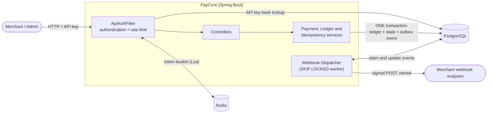
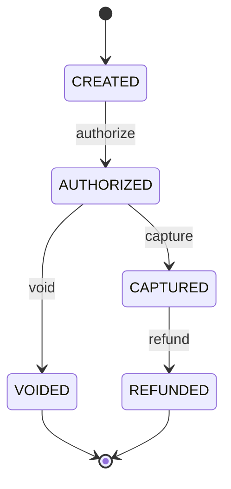

<div align="center">

# PayCore

**A concurrency-safe payment processing backend: double-entry ledger, idempotent APIs, signed webhooks and distributed rate limiting.**


</div>

PayCore is a small payment processor in the spirit of Stripe or Razorpay. It focuses on the hard parts of moving money
reliably: never charging twice, never overdrawing under concurrency, never losing an event, and being able to prove that
the books balance.

---

## Table of Contents

- [Highlights](#highlights)
- [Architecture](#architecture)
- [Quick Start](#quick-start)
- [Authentication](#authentication)
- [Payment Lifecycle](#payment-lifecycle)
- [API Walkthrough](#api-walkthrough)
- [Webhooks](#webhooks)
- [Design Decisions](#design-decisions)
- [Testing](#testing)
- [Performance](#performance)
- [Project Structure](#project-structure)
- [Limitations & Roadmap](#limitations--roadmap)

---

## Highlights

| Area | What it does |
|---|---|
| **Double-entry ledger** | Append-only entries; every transfer is a matched debit and credit. A reconciliation endpoint proves the books balance. |
| **Payment state machine** | `CREATED → AUTHORIZED → CAPTURED → REFUNDED` (or `VOIDED`) with illegal transitions rejected. |
| **Idempotency** | `Idempotency-Key` header; retries never double-charge, even when sent simultaneously. |
| **Concurrency safety** | Pessimistic row locks in a fixed order (no deadlocks), plus a database `CHECK` as a backstop. |
| **Authentication** | Hashed, revocable merchant API keys with strict tenant isolation; separate admin key. |
| **Rate limiting** | Redis token bucket executed atomically in Lua; `429` with `Retry-After`. |
| **Webhooks** | Transactional outbox, HMAC-signed requests, exponential backoff with jitter, dead-letter queue and replay. |
| **Scalability work** | Escrow account sharding removed a single-row lock bottleneck: **4.4× throughput** (673 → 2,991 req/s) and **−80% p95 latency** in k6 load tests. |

---

## Architecture



Every state change writes the ledger entries, the new payment status **and** the webhook event in a single database
transaction. Nothing is sent to the outside world until that transaction has committed.

---

## Quick Start

**Requirements:** Docker Desktop. Python 3 only for the test scripts.

```bash
docker compose up --build
```

| Service | Address |
|---|---|
| Backend API | `http://localhost:8080` |
| Swagger UI | [localhost:8080/swagger-ui.html](http://localhost:8080/swagger-ui.html) (use the **Authorize** button) |
| PostgreSQL | `localhost:5432` |
| Redis | `localhost:6379` |

---

## Authentication

| Caller | Header | Used for |
|---|---|---|
| **Admin** | `X-Admin-Key: dev-admin-key` (set `ADMIN_KEY` to change) | Create accounts, deposits, issue/revoke API keys, `/admin/**` |
| **Merchant** | `Authorization: Bearer pk_...` | `/payments/**` and `/webhooks/**`, scoped to that merchant only |

- API keys are 256-bit random values. Only a SHA-256 hash is stored and the key is shown **once**.
- A merchant requesting another merchant's payment gets `404`, indistinguishable from a payment that does not exist.
- Idempotency keys are scoped per caller, so two merchants using the same string never collide.

---

## Payment Lifecycle



### Money movement

| Operation | Source | Destination |
|---|---|---|
| Deposit | `FUNDING` | Customer |
| Authorize | Customer | Escrow |
| Capture | Escrow | Merchant |
| Void | Escrow | Customer |
| Refund | Merchant | Customer |

> **Precision:** all amounts are integers in minor units (paise). Floating point is never used for money.

---

## API Walkthrough

> Prefer clicking? Everything below is also available in Swagger UI.

```bash
ADMIN='X-Admin-Key: dev-admin-key'
```

**1. Create accounts** (admin) and note the returned ids as `CUSTOMER` and `MERCHANT`:

```bash
curl -s -X POST localhost:8080/accounts -H "$ADMIN" -H 'Content-Type: application/json' \
  -d '{"name":"alice","type":"CUSTOMER"}'
curl -s -X POST localhost:8080/accounts -H "$ADMIN" -H 'Content-Type: application/json' \
  -d '{"name":"shop","type":"MERCHANT"}'
```

**2. Issue a merchant API key** (admin). Save `apiKey` as `KEY`:

```bash
curl -s -X POST localhost:8080/admin/merchants/$MERCHANT/api-keys -H "$ADMIN" \
  -H 'Content-Type: application/json' -d '{"name":"demo"}'
```

**3. Deposit ₹500.00** into the customer (admin):

```bash
curl -s -X POST localhost:8080/accounts/$CUSTOMER/deposit -H "$ADMIN" \
  -H 'Content-Type: application/json' -H 'Idempotency-Key: dep-1' -d '{"amount":50000}'
```

**4. Create a ₹120.00 payment** (merchant). Save the returned `id` as `PAYMENT`:

```bash
curl -s -X POST localhost:8080/payments -H "Authorization: Bearer $KEY" \
  -H 'Content-Type: application/json' -H 'Idempotency-Key: pay-1' \
  -d "{\"customerId\":\"$CUSTOMER\",\"merchantId\":\"$MERCHANT\",\"amount\":12000}"
```

**5. Authorize, then capture** (merchant):

```bash
curl -s -X POST localhost:8080/payments/$PAYMENT/authorize -H "Authorization: Bearer $KEY" -H 'Idempotency-Key: auth-1'
curl -s -X POST localhost:8080/payments/$PAYMENT/capture   -H "Authorization: Bearer $KEY" -H 'Idempotency-Key: cap-1'
```

**6. Verify the books** (admin):

```bash
curl -s localhost:8080/admin/reconcile -H "$ADMIN"
```

### Endpoint reference

| Method | Path | Auth | Purpose |
|---|---|---|---|
| `POST` | `/accounts` | Admin | Create a `CUSTOMER` or `MERCHANT` account |
| `GET` | `/accounts/{id}`, `/accounts/{id}/ledger` | Admin | Balance and ledger entries |
| `POST` | `/accounts/{id}/deposit` | Admin | Fund an account (idempotent) |
| `POST` | `/admin/merchants/{id}/api-keys` | Admin | Issue an API key (shown once) |
| `DELETE` | `/admin/api-keys/{id}` | Admin | Revoke an API key |
| `GET` | `/admin/reconcile` | Admin | Verify balances against the ledger |
| `POST` | `/payments` | Merchant | Create a payment (idempotent) |
| `GET` | `/payments/{id}` | Merchant | Read a payment you own |
| `POST` | `/payments/{id}/authorize \| capture \| void \| refund` | Merchant | State transitions (idempotent) |
| `POST` `GET` | `/webhooks` | Merchant | Register / list webhook endpoints |
| `DELETE` | `/webhooks/{id}` | Merchant | Deactivate an endpoint |
| `GET` | `/webhooks/events?status=DEAD` | Merchant | Inspect deliveries (`PENDING`, `DELIVERED`, `DEAD`) |
| `POST` | `/webhooks/events/{id}/replay` | Merchant | Re-queue a dead event |

---

## Webhooks

Register an endpoint with `POST /webhooks` and PayCore notifies it of `payment.created`, `payment.authorized`,
`payment.captured`, `payment.voided` and `payment.refunded`.

### Delivery guarantees

- **At-least-once.** Receivers must de-duplicate on the event `id`. Ordering is not guaranteed.
- **Retries** with exponential backoff and ±20% jitter: 2s, 4s, 8s, 16s, 32s, 64s, 128s (defaults), then the event moves to
  `DEAD` (the dead-letter queue). A merchant can fix their server and `replay` it.
- **Crash safe.** Workers claim events with a time-limited lease; if a server dies mid-delivery, another retries.

### Verifying the signature

Every request carries `X-PayCore-Signature: t=<unix seconds>,v1=<hex HMAC-SHA256>` computed over `"<t>." + raw body`
with your endpoint's secret.

```python
import hashlib, hmac, time

def verify(secret: str, header: str, raw_body: bytes) -> bool:
    parts = dict(p.split("=", 1) for p in header.split(","))
    expected = hmac.new(secret.encode(), parts["t"].encode() + b"." + raw_body, hashlib.sha256).hexdigest()
    return hmac.compare_digest(expected, parts["v1"]) and abs(time.time() - int(parts["t"])) < 300
```

The timestamp check rejects replays of captured requests.

---

## Design Decisions

### 1. Double-entry ledger
Every transfer writes a matching `DEBIT` and `CREDIT` linked by a transaction id. The ledger is append-only, and
`/admin/reconcile` verifies that each stored balance equals its ledger sum and that total debits equal total credits.

### 2. Pessimistic row locking
`SELECT ... FOR UPDATE` on the payment, then on the participating accounts **in ascending id order**, so two opposite
transfers can never deadlock. Pessimistic locking was chosen over optimistic locking because contention on shared rows
(escrow) would otherwise cause constant retry storms.

### 3. Escrow sharding
All authorizations originally locked one shared escrow row, serializing every payment in the system. Held funds can now
be spread across up to 16 escrow accounts (`ESCROW_SHARDS`, default 16). The shard is derived from the payment id at authorization
and stored on the payment so capture and void use the same account. See [Performance](#performance) for measurements.

### 4. Idempotency inside the transaction
`INSERT ... ON CONFLICT DO NOTHING` on the key runs in the **same transaction** as the business action.

| Scenario | Behaviour |
|---|---|
| Same key + same request | Stored response replayed (`Idempotent-Replay: true`) |
| Same key + different request | `422` |
| Two identical requests at the same instant | The second blocks until the first commits, then replays |
| Request fails | Everything rolls back including the key, so the client can retry |

### 5. Database-level safety net
`CHECK (balance >= 0)` on non-system accounts stops an overdraft even if application code is wrong.

### 6. Transactional outbox for webhooks
Events are inserted in the same transaction as the payment change, which removes the "dual write" problem: an event exists
if and only if the payment change committed. A worker claims due rows with `FOR UPDATE SKIP LOCKED`, so several app
instances can run safely, and HTTP calls are made outside any database transaction.

### 7. Rate limiting that fails open
A token bucket per API key lives in Redis and runs as one Lua script (atomic, and it uses Redis' own clock so servers
cannot disagree about time). If Redis is unreachable the limiter allows traffic rather than taking payments down.

### 8. SSRF protection
Merchants choose the URLs the server calls. Webhook targets are rejected if they resolve to private, loopback or
link-local addresses (checked at registration and again at delivery), and redirects are never followed.

### 9. Crash safety
Each transfer is one PostgreSQL transaction, so a crash cannot leave a debit without its credit.

---

## Testing

Start the stack, then run:

```bash
python scripts/concurrency_test.py   # core correctness, security and rate limiting
python scripts/webhook_test.py       # webhook delivery, retries, DLQ and replay
```

| Suite | What it proves |
|---|---|
| Idempotency race | 20 parallel requests with one key create exactly one payment |
| Key reuse | Same key with a different body is rejected (`422`) |
| Overdraw race | 30 parallel authorizations on a ₹1.00 balance: exactly 10 succeed, balance never negative |
| Capture race | 10 parallel captures move money exactly once |
| State machine | Refund before capture is rejected (`409`) |
| Authentication | Missing, fake and revoked keys are rejected; merchant keys cannot call admin endpoints |
| Tenant isolation | A merchant cannot read, modify or create payments for another merchant |
| Idempotency scoping | The same key string from two merchants yields two separate payments |
| Rate limiting | A burst of 1000 requests is throttled with `429` and `Retry-After` |
| Reconciliation | Total debits equal total credits and every balance matches its ledger |
| Webhook retries | A receiver that fails the first two attempts still gets every event |
| Webhook signatures | Every delivery verifies against the endpoint secret |
| Dead-letter queue | An unreachable endpoint ends `DEAD`; replay delivers it once the endpoint is back |

---

## Performance

Load is generated with [k6](https://k6.io) running inside Docker Compose. Each virtual user repeatedly performs a full
checkout (create, authorize, capture) against its own customer and merchant, so the only shared resource is the escrow
account. This isolates the escrow lock as the variable under test.

**Step 0: switch off per-key rate limiting for the test.** Each virtual user hammers a single merchant key, so the
limiter (50 req/s per key) would reject most requests and hide the real behaviour. In `docker-compose.yml`, remove the
`#` from the two `RATE_LIMIT_*` lines under `app`, then apply it:

```bash
docker compose up -d app
```

Then run the experiment:

```bash
# 1. warm-up run (results discarded)
docker compose --profile loadtest run --rm -e LABEL=warmup -e VUS=10 -e DURATION_S=15 k6

# 2. baseline: ESCROW_SHARDS: "1" in docker-compose.yml
docker compose --profile loadtest run --rm -e LABEL=baseline k6

# 3. set ESCROW_SHARDS: "16" in docker-compose.yml, then restart the app and warm it up again
docker compose up -d app
docker compose --profile loadtest run --rm -e LABEL=warmup -e VUS=10 -e DURATION_S=15 k6
docker compose --profile loadtest run --rm -e LABEL=sharded k6

# 4. print a comparison table
python loadtest/compare.py baseline sharded
```

When finished, put the `#` back on the two `RATE_LIMIT_*` lines and run `docker compose up -d app` again.

> A run with more than 5% errors is flagged as invalid by the script, and `compare.py` refuses to compare it.

### Results

> **Setup:** 50 concurrent virtual users for 60 s, each with its own customer and merchant, 0% errors in both runs.
> Per-key rate limiting was switched off for the test. App, PostgreSQL, Redis and k6 all ran on one machine
> (Docker Desktop), so absolute numbers depend on hardware; the **relative** change is the finding.
> **Measured on:** _CPU / RAM / OS (fill in)_.

| Metric | Single escrow | 16 escrow shards | Change |
|---|---:|---:|---:|
| Throughput (req/s) | 673.4 | 2,991.1 | **+344% (4.4×)** |
| authorize p95 (ms) | 185.3 | 37.1 | **−80%** |
| authorize p99 (ms) | 248.0 | 57.8 | −77% |
| capture p95 (ms) | 190.9 | 38.2 | −80% |
| capture p99 (ms) | 258.0 | 60.1 | −77% |
| Error rate | 0.0% | 0.0% | none |

Raw results: [`loadtest/results/baseline.json`](loadtest/results/baseline.json) and
[`loadtest/results/sharded.json`](loadtest/results/sharded.json).

**What the numbers show**

- With one escrow account, every authorize and capture queues on the same row lock. 673 req/s is about 224 checkouts/s,
  or roughly 450 escrow-locking transactions/s, which works out to each transaction holding the lock for about 2 ms
  *in series*. The 185 ms p95 is mostly time spent waiting in that queue, not doing work.
- Spreading funds over 16 escrow accounts lets transactions on different shards run in parallel: 4.4× the throughput
  and an 80% drop in tail latency.
- The gain is 4.4× rather than 16× because the bottleneck moved to resources that are still shared (CPU on one machine,
  PostgreSQL commits, the 30-connection pool) and because hashing 50 concurrent payments over 16 shards still produces
  some collisions. Finding the next bottleneck needs metrics (see roadmap).

---

## Project Structure

```text
paycore/
├── docker-compose.yml          # app, PostgreSQL, Redis (+ k6 under the "loadtest" profile)
├── Dockerfile
├── pom.xml
├── docs/PROJECT_CONTEXT.md     # full project context / handoff notes
├── loadtest/                   # k6 script, comparison tool, saved results
├── scripts/                    # concurrency_test.py, webhook_test.py
└── src/main
    ├── resources
    │   ├── application.yml
    │   ├── redis/token_bucket.lua
    │   └── db/migration/       # V1 core, V2 api keys, V3 webhooks, V4 escrow shards
    └── java/com/paycore
        ├── common/             # ApiException, system account ids
        ├── config/             # OpenAPI and scheduling config
        ├── domain/             # Account, Payment, LedgerEntry, PaymentStatus
        ├── repo/               # Spring Data repositories (with row-lock queries)
        ├── security/           # auth filter, API keys, Redis rate limiter
        ├── service/            # Ledger, Payment, Account, Idempotency, Reconciliation
        ├── webhook/            # outbox service, dispatcher, signer, SSRF guard
        └── web/                # REST controllers and error handling
```

---

## Limitations & Roadmap

| Area | Status |
|---|---|
| Escrow contention | Mitigated by sharding; merchant and customer rows can still be hot for very busy single accounts |
| Idempotency keys | Scoped per caller but never expire; a retention job is needed |
| Webhooks | At-least-once and unordered; one dispatcher instance polls (safe to run several) |
| API key lookup | One database query per request; a short-lived cache would help |
| Webhook secrets | Stored in plaintext because the server must sign with them |

**Roadmap**

- [x] Double-entry ledger, state machine, idempotency, locking, reconciliation
- [x] API-key authentication, tenant isolation, Redis rate limiting
- [x] Webhooks with outbox, signing, retries, dead-letter queue and replay
- [x] k6 load test and escrow sharding
- [ ] Java integration tests (Testcontainers) and CI
- [ ] Fraud rules (velocity and amount checks)
- [ ] Metrics and dashboards (Micrometer, Prometheus, Grafana)
- [ ] Public deployment

---

<div align="center">

**PayCore**: reliable money movement through transactional consistency, concurrency control and double-entry accounting.

</div>
